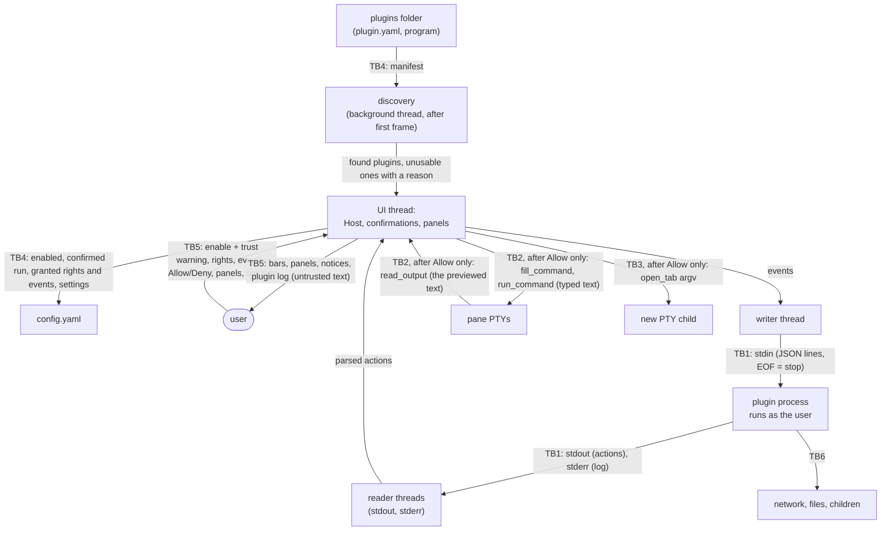

# Threat model: plugins

## 1. Component overview

How spec 0016 runs plugins: standalone programs in
`<data_local_dir>/tern/plugins/<id>/`, each described by a `plugin.yaml`,
enabled by the user and started by their first event, one process per
plugin, which may exit and is started again by its next event. Tern
writes events as JSON lines to a plugin's stdin, one at a time (the next
after the plugin's `ready` or its exit), and reads actions as JSON lines
from its stdout; stderr is the plugin's log. Most actions fill the
plugin's own panels and notices. The ones that type into a terminal, read
from it or open a tab wait for the user's Allow on a bar on the target
pane, or are carried by a command button in a panel that shows its
command: its click types a `fill_command`, and raises that bar for a
`run_command` or an `open_tab`.

Trust boundaries:

- **TB1** plugin process ↔ Tern: everything on its stdout and stderr is
  untrusted input, like escape sequences (architecture §Security 1);
  events on its stdin are what Tern discloses to it.
- **TB2** Tern ↔ terminals: text a plugin asks to type, and terminal
  output a plugin asks to read. Terminal output itself comes from programs
  and remote hosts (threat model 0002), so it can be crafted to steer a
  plugin that reads it.
- **TB3** Tern → a program started by `open_tab`, with an argv the plugin
  chose.
- **TB4** disk ↔ discovery: plugin folders, manifests and the `plugins:`
  block of `config.yaml`, which the user, an installer, a sync tool or an
  enabled plugin can change.
- **TB5** user ↔ the plugin UI: which plugin asks, what exactly would be
  typed, run or sent, and where.
- **TB6** plugin process ↔ the rest of the machine: its network, files and
  child processes. Tern can't gate these (OQ-031) and only decides when
  the process starts and stops.

**Whom the gates are for.** Enabling a plugin is the user's trust decision
(OQ-031): an enabled plugin runs as the user and can do anything the user
can, including editing `config.yaml` or other plugins. Rights and
confirmations can't stop a malicious plugin. They stop an honest plugin
that is buggy, over-eager or steered by hostile input, such as an AI
assistant that read a prompt injection in terminal output. That plugin is
the attacker this model designs against.

Out of scope: a malicious enabled plugin's own actions outside the
protocol (accepted in OQ-031), an attacker running as the user or as root,
installing and updating (Phase 6), file-browser targets (T-070), theme
plugins (data read by the boot path), and the app sidebar's own layout
(T-064).

## 2. Data classification

| Data | Category (GDPR) | Special constraints | Storage | Retention |
|---|---|---|---|---|
| Terminal output sent by `read_output` | Can be anything: Art. 4(1) personal data, Art. 9 special categories, secrets | Leaves Tern only per Allow, exactly as previewed; never logged, never kept (ground rule 4) | Memory, then the plugin's | Until delivered; the plugin's own after that |
| Text typed by `fill_command` and `run_command` | Can be anything the plugin chose | Untrusted text (§Security 1); never logged | Memory | Until carried out or dropped |
| Pane details (title, cwd, profile, host), with `pane_info` | Art. 4(1): names the user's accounts and hosts; a title can carry what the shell put there | Sent only with the right granted | Memory, then the plugin's | The plugin's |
| Plugin settings | Whatever the plugin asks for; Tern stores no secrets (spec 0016) | Plain text in `config.yaml`, which roams on Windows | `config.yaml` | Until the user changes it |
| Panel contents, notices, plugin log (stderr) | Can be anything the plugin received or produced, terminal text included | Untrusted text; memory only, never written to disk | Memory | Until the plugin restarts or Tern quits |

No sector law applies: architecture §Ground rules names none. Tern sends
nothing off the machine. What a plugin sends is the plugin's own doing
(OQ-031).

## 3. STRIDE walkthrough

Impact and likelihood are H/M/L, judged with spec 0016's design and the
mitigations below in place. Every mitigation not already in spec 0016 is
added to it in the same change. The status names the task that builds it.

| ID | STRIDE | Threat | Affected element | Impact | Likelihood | Mitigation | Status |
|---|---|---|---|---|---|---|---|
| TM-plug-01 | Spoofing | A plugin poses as another plugin, or as Tern: it names itself `Tern` or `SSH Hosts`, or takes another plugin's name, so its bar or notice reads as a request the user already trusts. | TB5 | H | L | Bars, notices, panel headers and log lines name the plugin from the Host's record of which process sent the action, never from the action's payload. Discovery lists a plugin as unusable when its `name` equals, ignoring case, another plugin's name or `Tern`. Manifest strings (`name`, titles) render by spec 0003's title rules, capped at 64 characters; `icon` names one of Tern's built-in icons, anything else gets the default (no image is read from a plugin). | mitigated (T-066, T-068, T-069) |
| TM-plug-02 | Spoofing | A panel imitates Tern's UI: a row saying "SSH session expired, enter your password" above its input field, or buttons laid out like a confirmation bar. | TB1 → TB5 | M | L | Tern draws every panel under a header naming the plugin. Panel items are a fixed set Tern renders (spec 0016); a plugin draws no UI of its own. Confirmation bars appear only on panes, never in the sidebar. A plain panel button only sends `panel_action` to its own plugin; one that runs something is a command button, which Tern draws with its command (TM-plug-23). `open_panel` never takes keyboard focus, so a plugin can't catch typing meant for a shell or a password prompt. | mitigated by design (T-069) |
| TM-plug-03 | Spoofing | The user allows a command on a pane other than the one they think: `run_command` targets a production SSH pane while they are looking at a local one. | TB5 → TB2 | H | L | The bar sits on its target pane and names that pane by its title, plus `user@host` for an SSH pane. The target is fixed when the request arrives (its `pane`, else the pane focused then) and doesn't follow focus. `plugin.allowRequest` and `plugin.denyRequest` act only on the request of the focused pane. | mitigated (T-068) |
| TM-plug-04 | Tampering | Text hides what it would run: a newline or ESC turns `fill_command` into a run, a direction override shows `ls` while the shell gets something else, zero-width characters disguise a word, or the payload sits past the visible width after a run of spaces. | TB1 → TB2, TB5 | H | M | `fill_command` and `run_command` text with any control character (Unicode `Cc`, spec 0016) or format character (`Cf`: direction overrides, zero-width characters, tag characters) is refused, and so is text over 4 KiB. The bar wraps and shows all of the text, never truncated, in the terminal's monospace font. Homoglyphs (a Cyrillic `с` in `сurl`, a look-alike letter in a URL) are not refused, since paths and messages legitimately hold non-ASCII text: every non-ASCII character is drawn highlighted, on a bar and on a command button, under a line saying the command contains non-ASCII characters (owner, OQ-035). A user whose own commands are full of non-ASCII text sees highlights often and may stop reading them. | mitigated (T-068, T-069) |
| TM-plug-05 | Tampering | `open_tab`'s argv runs more, or other, than the bar shows. On Windows a `.bat` or `.cmd` program goes through `cmd.exe`, which re-parses its arguments (`&`, `\|`, quotes), or a program name with a `"` breaks the command line. | TB3 | H | L | The bar and a command button show each argv element in a box of its own, so where one ends is never a guess and no added quote can be taken for the element's own, with the same character rules as TM-plug-04. Linux passes the argv to `execvp` unchanged. On Windows the PTY already escapes each argument (`escape_args`, T-074). An `open_tab` whose program contains `"` or ends in `.bat` or `.cmd` (ignoring case) is refused. Nothing from an event or action ever reaches a shell or `run` (spec 0016). | mitigated (T-068), checked on Windows |
| TM-plug-06 | Tampering | What is carried out differs from what was shown: the plugin sends a new action after the bar appeared, or the terminal prints more between the `read_output` preview and the send. | TB2, TB5 | H | L | Tern keeps the parsed action and, for `read_output`, the snapshot taken when the bar appeared. Allow carries out exactly that, and the `output` event carries exactly the snapshot (AC6). A second request from the same plugin is refused while one is pending. | mitigated (T-068) |
| TM-plug-07 | Elevation of privilege | Allow is clicked by accident: the bar appears, or a second bar shifts the layout, just as the user clicks at that spot. | TB5 | H | L | Allow ignores clicks for 0.5 s after its bar appears or moves. The bar never takes keyboard focus, so typing and Enter go to the shell (spec 0016, AC4). Binding a key to `plugin.allowRequest` is the user's choice, and no default key is bound. | mitigated (T-068) |
| TM-plug-08 | Elevation of privilege | A plugin steered by hostile input chains read and write: a remote host prints a prompt injection, an AI plugin reads it with `read_output` and asks `run_command` with `curl … \| sh`. | TB2 → TB1 → TB2 | H | M | Every read and every write is its own confirmation, every time. There is no "always allow" in `api: 1` (spec 0016), the bar shows the exact command (TM-plug-04), and `output` carries only the previewed text. The user can still allow a harmful command that looks fine. | mitigated by design (T-068); approving harm accepted (OQ-035) |
| TM-plug-09 | Denial of service | Confirmation spam: after a Deny the plugin asks again at once, over and over, until the user gives in or can't work. | TB5 | M | M | One pending request per plugin (spec 0016). After a Deny, that plugin's confirmed actions are refused (`refused`) until the user next runs one of its commands or acts in one of its panels. Spam then needs the user's own action each time. | mitigated (T-068) |
| TM-plug-10 | Denial of service | Floods: millions of actions or log lines, a 1 GiB line, a huge `set_panel`, a plugin that never reads its stdin so Tern's writes block, or events piling up behind a plugin that never sends `ready`. | TB1 | M | M | Per spec 0016: lines over 1 MiB dropped, panel logs keep 10,000 lines, readers hand over a bounded channel so a flood blocks the plugin, not the UI. Added here: JSON is parsed on the reader thread; the stderr log keeps its last 10,000 lines, in memory only; each plugin has one writer thread with a queue of 256 events, and an event that doesn't fit is dropped with one line in the plugin's log; a plugin that stalls holds up only its own events and is not killed for it, the user disables it; panels draw only their visible rows. | mitigated (T-066, T-069) |
| TM-plug-11 | Denial of service | Processes left behind: a plugin ignores EOF, or ends itself but leaves its children (`docker logs -f`, an agent's subprocesses) running after it was disabled or Tern quit. A crash of Tern closes the plugin's stdin, so a plugin that honors EOF still ends. | TB6 | M | M | Spec 0016: EOF means stop, then after 2 s Tern kills the PID it spawned, only while it still holds the unreaped `Child`, never by name (AGENTS.md hazard 3, as in TM-fwd-14). That alone leaves a plugin's children, so the kill takes the tree (owner, OQ-035): Linux starts each plugin as the leader of its own process group (`process_group(0)`, in std) and kills the group with `killpg` while the leader is unreaped, which needs `libc`. Windows gives each plugin process its own Job object (`KILL_ON_JOB_CLOSE`), which also covers a crash of Tern. A child that deliberately leaves its group (`setsid`, a breakaway job) is beyond Tern (OQ-031), and on Linux so are the children of a plugin that exited by itself. | mitigated (T-066) |
| TM-plug-12 | Tampering | The manifest changes under an enabled plugin: an update, a sync tool or another plugin swaps its `run` for a different program. Tern starts what the user never saw at enabling, or a roaming `config.yaml` enables a different folder of the same ID on another machine. | TB4 | M | L | The enable confirmation stores the `run` it showed as `plugins.<id>.run` in `config.yaml`. A manifest whose `run` differs is not started, and the Plugins tab asks for the enable confirmation again. Rights and events a new manifest adds stay off (spec 0016). Changing the program's own files in place is an update the user made and isn't detected. | mitigated (T-066, T-067) |
| TM-plug-13 | Tampering | A hostile `plugin.yaml` (a YAML alias bomb, a huge file, odd strings) stalls or crashes discovery. | TB4 | L | L | Discovery runs on a background thread after the first frame. A manifest over 64 KiB is unusable without being parsed, and a parse error or `serde-saphyr`'s alias budget makes it unusable with the reason (flow 1). Nothing in a manifest is shown before TM-plug-01's text rules. | mitigated (T-066) |
| TM-plug-14 | Elevation of privilege | A plugin's process inherits a PTY master's file descriptor or handle from Tern and writes to a terminal directly, past every confirmation. | TB1 → TB2 | H | L | Plugins are spawned with only their three pipes. On Unix every descriptor Rust and `alacritty_terminal` open is close-on-exec. T-066 checks it: on Linux the plugin's `/proc/<pid>/fd` lists only 0, 1 and 2; on Windows a handle listing shows no ConPTY pipe. A leak found there is a `type: bug` before T-068 ships. | mitigated (checked in T-066) |
| TM-plug-15 | Elevation of privilege | Injection through `run`: event data, a setting or a path ends up on a plugin's command line or in a shell, or `run`'s program is found in an unexpected place (a `python.exe` dropped in the plugin folder on Windows). | TB4 → TB6 | H | L | `run` is spawned as an argv, never through a shell, and nothing from an event, action or setting is put on it (spec 0016). A program starting with `./` resolves inside the plugin folder; a bare name resolves on `PATH`, and Rust's spawn on Windows doesn't search the working directory. | mitigated by design (T-066) |
| TM-plug-16 | Information disclosure | Terminal contents or pane details reach a plugin unasked: the `command` event carries the focused pane's title, or `read_output` sends more than the user saw. | TB2 → TB1 | H | L | Terminal output crosses only per allowed `read_output`, as the previewed snapshot (TM-plug-06). The bar states the line and character count above its scrollable preview, so a 1,000-line read doesn't pass as a short one. Events carry opaque pane IDs, with title, cwd, profile and host only when `pane_info` is granted. Events the user didn't tick are never sent (spec 0016). A title can carry what the shell put there (a command line). | mitigated (T-066, T-068); what `pane_info` reveals accepted (OQ-035) |
| TM-plug-17 | Information disclosure | Plugin data lands on disk or in a log: event payloads, `read_output` text, or a plugin's stderr echoing terminal text in Tern's log or a crash report. | All | H | L | Tern logs no event or action payload (spec 0016). The plugin log and panel logs live in memory only, and Tern has no crash reporter. | mitigated (T-066, T-069) |
| TM-plug-18 | Information disclosure | A plugin asks for a token in a text setting ("API key"), and the user's secret goes into `config.yaml` in plain text, which roams on Windows. | TB5 → TB4 | M | M | The plugin's settings page states that its fields are saved in `config.yaml` as plain text and are no place for secrets. Settings of type secret (keychain) are *Later* (spec 0016). | partly mitigated (T-067); residual accepted (OQ-035) |
| TM-plug-19 | Information disclosure | One plugin learns another's activity: its panel input, settings or action results. | TB1 | M | L | The Host routes each event to the plugin whose manifest declares the command or panel, and sends `settings`, `action_result` and `output` only to the plugin that owns them. No event names another plugin. | mitigated by design (T-066) |
| TM-plug-20 | Repudiation | Something was typed into a terminal and the user can't tell which plugin asked, or whether they allowed it. | TB5 | L | L | Every write needed the user's Allow on a bar naming the plugin. The plugin log on the Plugins tab gets one line per confirmed action with its kind, target pane, outcome and time, in memory only, without the text, which may be terminal output. | mitigated (T-068) |
| TM-plug-21 | Tampering | Text typed by `fill_command` or `run_command` lands after whatever is already on the line, or in a program that isn't a shell (vim, a REPL), where the same keystrokes mean something else. | TB2 | M | L | The bar names the pane and shows the exact text. Tern can't see what the line holds or what the pane runs, and clearing the line first would mean writing a control character the user didn't see. | accepted (OQ-035) |
| TM-plug-22 | Elevation of privilege | An enabled plugin edits `config.yaml` to grant itself rights or enable another plugin, or kills or rewrites another plugin. | TB6 → TB4 | H | L | Tern can't stop a program running as the user; this is the trust decision of enabling (OQ-031, trusted-source warning). Self-granted rights still need a confirmation for every terminal action (TM-plug-08). | accepted (OQ-031) |
| TM-plug-23 | Elevation of privilege | A command button runs what the user didn't mean: its label says "Refresh" while it carries `curl … \| sh`, a `set_panel` swaps the command just as the user clicks, or the text lands in a pane the user isn't looking at. A plugin steered by hostile input (TM-plug-08) can set such a button. | TB1 → TB5 → TB2, TB3 | H | M | Tern draws a command button with all of its text or argv under the label, never truncated, in the terminal's monospace font, under TM-plug-04's and -05's rules; the label can't replace or cover it. The button ignores clicks for 0.5 s after its panel's contents changed. It can't name a pane: its text goes to the terminal pane that last had focus. It needs the action's right and is drawn disabled without it. `read_output` is never on a button. Only a `fill_command` button acts on its click, and it types without Enter; a click on a `run_command` or `open_tab` button raises the confirmation bar of TM-plug-03 to -07, and nothing runs before Allow (owner, OQ-035). Each command adds TM-plug-20's log line. A filled line still runs on the user's own Enter, as after a bar. | mitigated (T-068, T-069) |

Every boundary of the sketch appears: TB1 in -02, -04, -08, -10, -14,
-16, -19, -23; TB2 in -03, -04, -06, -08, -14, -16, -21, -23; TB3 in -05,
-23; TB4 in -12, -13, -15, -18, -22; TB5 in -01, -02, -03, -04, -06, -07,
-09, -18, -20, -23; TB6 in -11, -15, -22.

## 4. Mitigation tasks

- [x] T-066: host (TM-plug-01's discovery check, -10, -12, -13, -14's
  check, -15, -16's event contents, -17, -19) and -11
- [ ] T-067: Plugins tab (TM-plug-12's re-confirmation, -18's note)
- [ ] T-068: confirmations (TM-plug-01's labels, -03 to -09, -16's count,
  -20), and a command button's click (-23): typing a fill, raising the
  bar for the rest
- [x] T-069: panels (TM-plug-01's header, -02, -10's visible rows, -17),
  and drawing command buttons (-23) with -04's highlight

## 5. Accepted risks

All answered in [OQ-035](../open-questions.md).

- TM-plug-04 is no longer one: the owner chose to highlight every
  non-ASCII character (2026-11-12).
- TM-plug-23 is no longer one: a button that runs something raises the
  bar (owner, 2026-11-12).

Accepted by the owner (2026-11-12):

- TM-plug-08: the user can allow a harmful command that looks fine.
- TM-plug-16: a granted `pane_info` sends pane titles, which can carry a
  command line.
- TM-plug-18: secrets a user types into a plugin setting are stored in
  plain text; the settings page warns.
- TM-plug-21: typed text lands after what's on the line, in whatever
  program the pane runs.

- TM-plug-11 was a choice, and the owner made it (2026-11-12): Tern kills
  each plugin's process tree.

Accepted earlier in [OQ-031](../open-questions.md): TM-plug-22, and
everything a plugin does outside the protocol.
